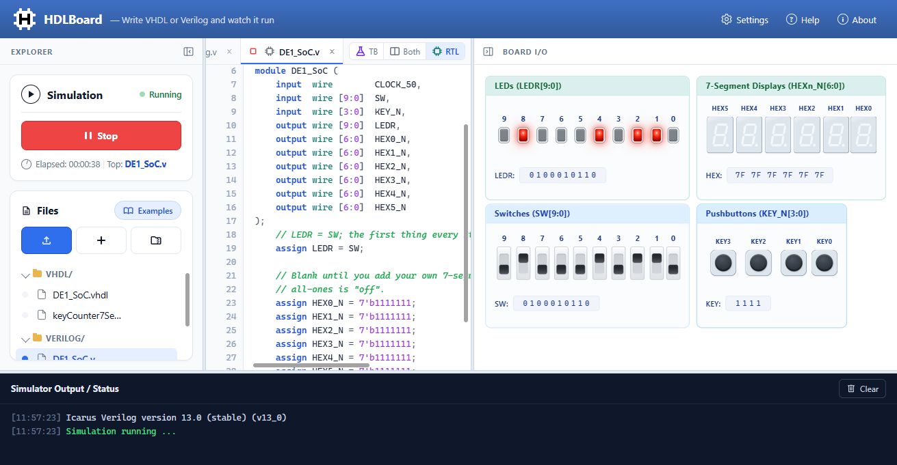
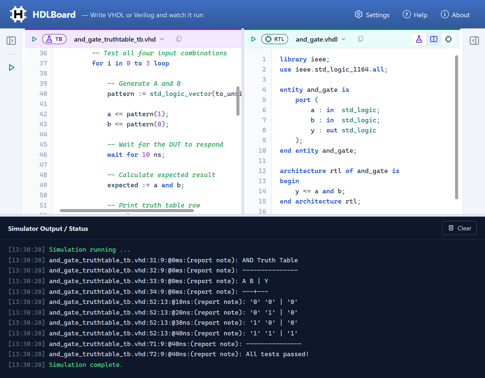

# HDLBoard — free online VHDL & Verilog simulator with an interactive FPGA board

[](https://hdlboard.onrender.com/)
[](https://github.com/rlangoy/HDLBoard/releases/latest)
[](LICENSE)

**Write VHDL or Verilog. Watch it light up.**

A free online simulator with a virtual FPGA board. Flip the switches while your design runs, and watch the LEDs respond.

**[Try it online](https://hdlboard.onrender.com/)** · **[Download for Windows](https://github.com/rlangoy/HDLBoard/releases)** · **[Host it yourself](docs/HOSTING.md)**



## Get started

### Try it in one minute

1. Open the [online simulator](https://hdlboard.onrender.com/) or start the Windows app.
2. The starter design already connects the switches to the LEDs:

   ```vhdl
   LEDR <= SW;
   ```

3. Press **Start**, then flip a few switches on the board. The matching LEDs light up.
4. Edit the line, for example to `LEDR <= not SW;` or `LEDR(0) <= SW(0) and SW(1);`, and start again.

For something with buttons and displays, open the **[4-bit adder and hex counter example](https://hdlboard.onrender.com/?project=projects/adder-and-counter/adder-and-counter.hdlboard.json)**. In it, KEY0 counts up, KEY1 resets, and the count is shown on the LEDs and in hex on the 7-segment displays. A self-checking testbench for the adder is included.

Every board port is optional, so a first lab can declare only `SW` and `LEDR`.

### Ways to run it

| Option | Best for | How |
|---|---|---|
| **Online** | Trying it out, with nothing to install | [hdlboard.onrender.com](https://hdlboard.onrender.com/) |
| **Windows app** | Working offline on your own PC. GHDL and Icarus Verilog are included. Every installer since 1.2.4 is built by GitHub Actions from this repository. It is not code-signed, so if SmartScreen warns, choose **More info → Run anyway**. | [Releases page](https://github.com/rlangoy/HDLBoard/releases) |
| **Self-hosted** | A classroom, lab or personal server (Docker on Linux, macOS or Windows/WSL) | [HOSTING.md](docs/HOSTING.md) |
| **From source** | Development and contributing | [BUILDING.md](docs/BUILDING.md) |

## What is HDLBoard?

HDLBoard is a free, open-source **online VHDL and Verilog simulator** for learning digital logic and FPGA design. It combines real HDL simulation with interactive virtual FPGA boards: **Terasic DE1-SoC and DE10-Lite**, **Digilent Basys 3 and Nexys A7**, a generic Default board, and configurable custom boards. Write real HDL, then flip the switches and press the buttons *while the simulation runs*, and watch the LEDs and 7-segment displays respond to your design. It runs in your browser with nothing to install, or as a Windows app. You don't need an FPGA board, a cable or a vendor toolchain.

Built for **students and teachers** in first digital-logic and FPGA courses, and for **hobbyists** who want to try HDL before buying hardware. HDLBoard covers the step between "my code compiles" and "my code does what I meant".

- **Make a mistake. See why in a second.** HDLBoard compiles your design in under a second, while Altera Quartus Prime needs more than five. Mistakes are marked right in your code, with a message that says what is wrong and a hint about how to fix it.
- **Find any signal at a glance.** Rest your mouse on a signal or port, or click it, and it lights up everywhere it appears: where it is declared and every place it is used. No more scrolling up and down to find where `sum` was declared.
- **Live interaction:** edit → Start → flip a switch → watch the LEDs change, all while the simulation is running.
- **Real boards, real pin names:** choose **DE1-SoC**, **DE10-Lite**, **Basys 3** or **Nexys A7** in Settings and the virtual board takes that board's parts and the vendor's own pin names — 16 switches and a 4-digit multiplexed display on the Basys 3, a button cross and a reset button on the Nexys A7, decimal points on the DE10-Lite — so your design is a starting point for Quartus or Vivado. Or keep **Default** (`KEY_N`, `HEX0_N`), which shows the active-low ports in their names. Changing the board renames the ports in your files where it can and lists what to change by hand, and you can design your own board, with the course's own parts and names, right in the app ([docs/BOARDS.md](docs/BOARDS.md)).
- **Real-time pacing:** an LED meant to blink once a second blinks once a second.
- **Real simulators:** [GHDL](https://github.com/ghdl/ghdl) (VHDL-2008) and [Icarus Verilog](https://github.com/steveicarus/iverilog), not a JavaScript approximation.
- **Testbenches side by side:** a self-checking testbench opens next to the design it drives, and its reports appear live in the console.
- **Waveforms ready for a report:** see what every signal did after a testbench run, jump straight to the first error, and save the traces as a print-ready figure for a lab report.

## Where it fits

| | Compile-and-waveform sites (e.g. EDA Playground) | Vendor tools (Quartus, ModelSim/Questa, Vivado) | **HDLBoard** |
|---|---|---|---|
| Real HDL simulator | Yes | Yes | **Yes** (GHDL, Icarus Verilog) |
| Interact with the design while it runs | No (you read waveforms or the console) | Only on a physical board | **Yes**, on a virtual board |
| Synthesis and bitstream for real hardware | No | Yes | No |
| Setup | None | Large install, licence for some tools | **None** (browser), or a small Windows installer |

HDLBoard is meant for the first weeks of HDL learning. When a design behaves the way you meant it to, take it to Quartus or Vivado and the real board.

## Built for teaching

HDLBoard was created for **PB1180 Programmerbare logiske kretser**, an introductory FPGA course at the University of South-Eastern Norway (USN). The course is taught in VHDL. Verilog support was added later so that people outside the course could use HDLBoard too.

In the first weeks of an FPGA course, students usually face several obstacles at once: a multi-gigabyte vendor toolchain, a synthesis flow, USB drivers, and a limited number of boards in the lab. HDLBoard puts those aside until later. A student can open a browser at home, write a few lines of VHDL or Verilog, and see right away whether the design behaves the way they meant.

Typical uses:

- **Lab exercises** in VHDL or Verilog, shared as a `?project=` link so everyone starts from the same files.
- **Homework and self-study**, without needing a board at home.
- **Classroom demonstrations:** change a line, press Start, and flip a switch while the class watches.
- **Self-checking testbenches** that students run next to their own design.
- **Lab reports** with waveform figures that are sized and styled for print.

## Features

### An interactive virtual board
- Choose the built-in **DE1-SoC**, **DE10-Lite**, **Basys 3**, **Nexys A7** or generic **Default** board in Settings. Each provides its own selection of switches, buttons, LEDs and 7-segment displays.
- **Design your own board.** Open **Settings › Board › View board settings** to make an editable copy of any board and shape it with the board editor: switches, pushbuttons, LEDs and 7-segment displays (any of them can be left out), their port names and polarities, and the clock frequency. The Board pane previews your changes as you type. Built-in boards stay read-only. Boards can also be added in a JSON file; see [BOARDS.md](docs/BOARDS.md).
- Inputs go to the simulation while it runs, and the design's outputs drive the board.
- **Real-time pacing:** simulated time follows the clock on your wall, so an LED meant to blink once a second blinks once a second.

### Real simulation, readable errors
- **VHDL** runs on GHDL (VHDL-2008). **Verilog** runs on Icarus Verilog.
- The simulator's own messages, including testbench `report`/`assert` and `$display` output, appear live in the console.
- Compiles in under a second. Errors are marked where they occur in your code, with a message that explains the likely cause and suggests a fix.

### Testbenches side by side



When you open a testbench, the editor splits: the testbench is on the left and the design it drives is on the right. Each pane has its own Play button.

### Waveforms of testbench runs
**Waveform** beside Clear shows what every signal did, in place of the code. If the testbench on screen has not been run yet, the button runs it first and opens the waveform when it is ready.

- **Testbench and RTL, side by side in colour.** The testbench's own signals are laid out already, with the value of each at the cursor beside its name. Tick a signal in the RTL section to add your design's internal signals.
- **Readable values.** State machines show their states by name (`idle`, `start_bit`, `data_bits`), an uninitialised `U` stands out in red, and hovering a value explains it.
- **Start where it went wrong.** A failing check opens the waveform zoomed in at the first error. A click on a time in the console jumps there, and Go to declaration takes you from a signal back to its line of code.
- **Move around quickly.** Drag across the traces to zoom in, unfold a vector into its bits, step from change to change with ← and →, or type a time (`24.5`, `3 us`) into the cursor field to jump there.
- **Put it in your lab report.** Copy waveform puts the view on the clipboard as it looks on screen. **Figure for a report** turns the traces into a print-ready figure sized for one or two columns (IEEE style, 9 pt text), in black and white or colour, with or without the cursor. Pan and zoom in the figure itself, then copy it or save it as SVG or a 600 dpi PNG.
- **Use other tools too.** VHDL is recorded as GHW, Verilog as VCD; Download waveform saves the file for GTKWave or Surfer.

### A small, focused editor
- Rest the mouse on a signal or port, or click it, to highlight its declaration and every use.
- Syntax highlighting for VHDL and Verilog, one file list with upload and drag-and-drop, and resizable panes.
- Download a single file, or the whole project as a ZIP.

### Projects and sharing
- A `.hdlboard.json` project file holds the project's name, board and files, with a description for each file.
- **Your board travels with the project.** A custom board's settings are saved in the project file itself, so the project can carry a board design that is not part of HDLBoard's built-in boards. Whoever opens the project, from a file, a link or a Gist, gets the board and its layout automatically, with nothing extra to install.
- Open a project from a file on your computer, a web address, a GitHub Gist or a `?project=` link. You can send that link to a class so everyone starts from the same exercise.
- **Save to GitHub:** sign in once, and each project is kept in a secret Gist on your own account. You can open, update and delete it from any computer, and HDLBoard checks before overwriting changes made somewhere else.

How to: [PROJECTS.md](docs/PROJECTS.md) · [GITHUB.md](docs/GITHUB.md)

## What HDLBoard is not

HDLBoard is a learning and simulation tool, not a replacement for an FPGA toolchain.

- It does **not** do synthesis, place-and-route, timing analysis or bitstream generation. To run on real hardware, add pin assignments and build with the appropriate vendor toolchain, such as Quartus or Vivado.
- The virtual boards model selected inputs and outputs, not every peripheral on the physical boards. Built-in profiles cover **DE1-SoC**, **DE10-Lite**, **Basys 3** and **Nexys A7**, as well as a generic Default board.
- A design that divides the real 50 MHz `CLOCK_50` down to a visible blink needs millions of simulated cycles, which is too slow to watch. For blinking and counting designs, declare the simulator-only `CLOCK_500Hz` port instead, and remove it before you build for the real board. See [Design_Description.md § 10](docs/Design_Description.md#10-known-limitations).
- Work is not saved automatically. Save the project to a folder, download a ZIP or save to GitHub before you close the page.

## FAQ

### Is there a free online VHDL simulator?

Yes. [HDLBoard](https://hdlboard.onrender.com/) runs VHDL on GHDL (VHDL-2008) and Verilog on Icarus Verilog, right in your browser. It is free and open source (GPL-2.0).

### Can I learn VHDL, Verilog or FPGA design without an FPGA board?

Write your design using the board's port names (`SW`, `KEY_N`, `LEDR`, `HEX0_N` …, or `KEY` and `HEX0` … on the DE1-SoC board) and press Start. The virtual board's switches, buttons, LEDs and 7-segment displays behave like the real ones, so you can test a design by playing with it.

### What is a DE1-SoC?

The DE1-SoC is a Terasic development board with an Intel (Altera) Cyclone V FPGA. Many universities use it for teaching digital logic. HDLBoard models its switches, pushbuttons, LEDs and 7-segment displays.

### Is HDLBoard suitable for a university or college FPGA course?

Yes. That is what it was built for. Send students a `?project=` link so everyone starts from the same exercise. You can also [host your own copy](docs/HOSTING.md) for a lab, or install the Windows app on lab PCs.

### Will my design run on a real FPGA?

HDLBoard does not do synthesis. Because it uses the board's real pin names, though, a working design is a good starting point: add pin assignments and build in Quartus or Vivado, as appropriate for the board.

## Documentation

- [BOARDS.md](docs/BOARDS.md) — built-in boards and custom board configuration
- [BUILDING.md](docs/BUILDING.md) — build from source, run the dev server, package the Windows app
- [HOSTING.md](docs/HOSTING.md) — self-host with Docker on Linux, macOS or Windows (WSL)
- [PROJECTS.md](docs/PROJECTS.md) — create, open, edit, save and publish projects
- [GITHUB.md](docs/GITHUB.md) — GitHub sign-in, Gist storage, syncing, and OAuth App settings for hosts
- [Design_Description.md](docs/Design_Description.md) — how the board components are built, features and known limitations
- [ghdl_implementation_plan.md](docs/ghdl_implementation_plan.md) — how the GHDL backend works
- [Verilog_implementation_plan.md](docs/Verilog_implementation_plan.md) — how the Icarus Verilog backend works
- [Impl_project_file_and_online_storage.md](docs/Impl_project_file_and_online_storage.md) — the `.hdlboard.json` project format
- [waveform_viewer_spec.md](docs/waveform_viewer_spec.md) — the waveform viewer: requirements, formats and implementation
- [winInstaller/README.md](winInstaller/README.md) — the Windows desktop build

## Support and contributing

- **Found a bug or have an idea?** [Open an issue](https://github.com/rlangoy/HDLBoard/issues). Please include the HDL file and the console output if you can.
- **Want to contribute?** Pull requests are welcome, whether they are fixes, features or example designs for teaching. Start with [BUILDING.md](docs/BUILDING.md).
- Feedback from students and teachers who use HDLBoard in a course is especially valuable.

## Credits

HDLBoard builds on the work of many open-source projects. Thank you to all of them and their contributors.

| Component | Used for | License |
|---|---|---|
| [GHDL](https://github.com/ghdl/ghdl) | Analyses, elaborates and simulates VHDL | GPL-2.0 |
| [Icarus Verilog](https://github.com/steveicarus/iverilog) | Compiles and simulates Verilog. The Windows build uses the [MSYS2](https://www.msys2.org/) packages, with GNU Readline, zlib, bzip2, termcap, winpthreads and the GCC runtime | GPL-2.0-or-later (Readline GPL-3.0-or-later; GCC runtime with the Runtime Library Exception) |
| [React](https://react.dev/) | The user interface | MIT |
| [ws](https://github.com/websockets/ws) | The WebSocket link between browser and simulator | MIT |
| [Electron](https://www.electronjs.org/) (with Chromium and Node.js) | The Windows desktop app | MIT (Chromium: BSD-style) |
| [electron-builder](https://www.electron.build/) and [NSIS](https://nsis.sourceforge.io/) | The Windows installer | MIT; zlib/libpng-style |
| [Vite](https://vite.dev/), [TypeScript](https://www.typescriptlang.org/), [esbuild](https://esbuild.github.io/), [Vitest](https://vitest.dev/), [ESLint](https://eslint.org/) | Building and testing | MIT, Apache-2.0 |

The license texts of the bundled simulators are installed with the Windows app and shown by its installer.

DE1-SoC and DE10-Lite are products of [Terasic Technologies](https://www.terasic.com.tw/). Basys 3 and Nexys A7 are products of [Digilent](https://digilent.com/). HDLBoard is an independent teaching tool and is not affiliated with or endorsed by Terasic or Digilent.

## License

HDLBoard is licensed under the [GNU General Public License v2.0](LICENSE).
